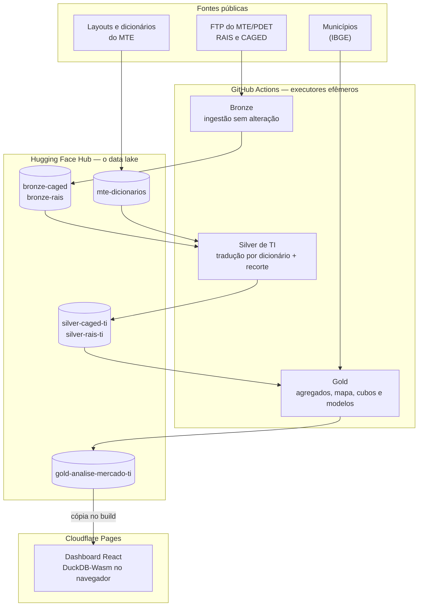
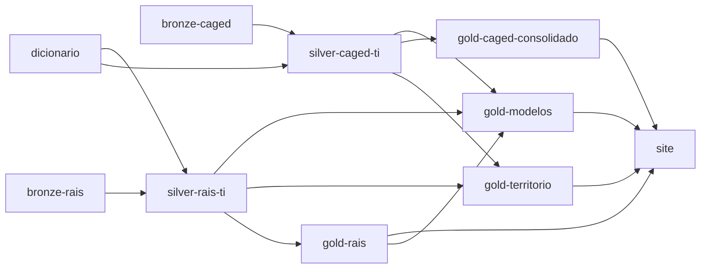

# mercadotech — o mercado de trabalho em tecnologia no Brasil

[](https://mercadotech.pages.dev/)
[](https://huggingface.co/datasets/Gianpedro/gold-analise-mercado-ti)
[](https://gitdiagram.com/gianse/mercadotech)

Plataforma analítica sobre os microdados públicos da **RAIS** e do **CAGED**
(Ministério do Trabalho e Emprego) que mede o emprego formal em tecnologia no
Brasil de 2007 a 2026: quanto cresceu, onde está, se melhorou em qualidade,
quem ganha menos e para onde vai.

É o Trabalho de Conclusão de Curso de **Gian Pedro Rodrigues** em Engenharia da
Computação na **UTFPR**, câmpus Cornélio Procópio, com orientação do
Prof. Me. Francisco Pereira Junior.

**→ Dashboard: [mercadotech.pages.dev](https://mercadotech.pages.dev/)**

---

## O que o projeto responde

O trabalho se organiza em cinco perguntas. Cada uma é uma página do dashboard
e uma seção do TCC.

| Pergunta | Resposta curta |
|---|---|
| **1. Quanto o mercado cresceu?** | O estoque de vínculos formais de TI passou de 560.040 em 2007 para 1.361.231 em 2025: **+143%**, com o salto concentrado em 2021–22. |
| **2. Onde está o trabalho de TI?** | **58%** dos profissionais de TI trabalham fora de empresas de TI. São Paulo concentra 41% do estoque, mas o crescimento não depende dele: sem SP, foi de 136%. |
| **3. O emprego melhorou em qualidade?** | Não em remuneração relativa: a mediana em salários mínimos subiu só 5% em 18 anos (3,24 → 3,41). O risco de desligamento é máximo entre 6 e 12 meses de casa. |
| **4. Quem ganha menos, e por quê?** | Mulheres e pessoas negras, por mecanismos distintos: o hiato de gênero (de 19,0% para 7,8%) é de retorno; o racial é sobretudo de acesso. |
| **5. Para onde o mercado vai?** | A previsão do saldo mensal (SARIMA) erra 31% menos que a regra ingênua sazonal; o *nowcast* do estoque errou 0,78% no ano retido. Estimar o presente é bem mais preciso que prever o futuro. |

Os números vêm da camada Gold e são os mesmos do TCC: as tabelas do texto são
geradas por script a partir dos dados publicados, nunca digitadas.

## O recorte de tecnologia

Nem a RAIS nem o CAGED marcam um vínculo como "de tecnologia". O recorte é a
**união de duas lentes**, guardadas como rótulos independentes em cada registro:

- **setor** — a empresa tem atividade de TI (CNAE 2.0);
- **ocupação** — o trabalhador exerce ocupação de TI (CBO 2002), em qualquer setor.

Manter as duas lentes separadas é o que mostra o achado central: a maior parte
do trabalho de TI acontece fora das empresas de TI, e existe um contingente
grande de pessoas em empresas de TI exercendo outras funções. Os códigos ficam
em [`escopo_tecnologia.py`](tasks-python/_utils/escopo_tecnologia.py) e são os
mesmos no pipeline e no site.

## Arquitetura

Arquitetura Medalhão (Bronze, Silver, Gold) executada inteiramente em nuvem e
sem servidor próprio: o processamento roda no **GitHub Actions**, o *data lake*
é um conjunto de repositórios públicos no **Hugging Face Hub**, e o dashboard é
um site estático no **Cloudflare Pages** que consulta os dados no próprio
navegador com **DuckDB-Wasm**.



Cada etapa lê a camada anterior e grava a seguinte direto no repositório
público. Não existe cópia local nem etapa de "publicar depois": o repositório
**é** o *data lake*.

| Camada | O que guarda | Repositório |
|---|---|---|
| **Bronze** | Microdados como saíram do FTP, convertidos para Parquet ZSTD-3: 661 GB de texto viram 56,4 GB no período analisado | [bronze-caged](https://huggingface.co/datasets/Gianpedro/bronze-caged) · [bronze-rais](https://huggingface.co/datasets/Gianpedro/bronze-rais) |
| **Dicionários** | Planilhas de *layout* do MTE convertidas, usadas para traduzir os códigos | [mte-dicionarios](https://huggingface.co/datasets/Gianpedro/mte-dicionarios) |
| **Silver de TI** | Só o recorte de tecnologia, com os códigos traduzidos e a procedência de cada linha: 23,8 milhões de vínculos da RAIS e 12,4 milhões de movimentações do CAGED | [silver-caged-ti](https://huggingface.co/datasets/Gianpedro/silver-caged-ti) · [silver-rais-ti](https://huggingface.co/datasets/Gianpedro/silver-rais-ti) |
| **Gold** | Agregados prontos para consumo, cubos do CAGED e resultados dos modelos (poucos MB) | [gold-analise-mercado-ti](https://huggingface.co/datasets/Gianpedro/gold-analise-mercado-ti) |

Os dados publicados usam a licença **ODC-BY**. Qualquer camada pode ser lida
direto, sem baixar nada antes:

```python
import duckdb

base = "https://huggingface.co/datasets/Gianpedro/gold-analise-mercado-ti/resolve/main"
duckdb.sql(f"SELECT * FROM read_parquet('{base}/rais_estoque_anual.parquet')")
```

Um diagrama navegável da estrutura do código está no
[GitDiagram](https://gitdiagram.com/gianse/mercadotech).

## Pipeline

O [orquestrador](.github/workflows/pipeline.yml) roda **toda segunda-feira**
e encadeia as etapas por dependência real de dados, não por horário:



- **Incremental.** Cada etapa primeiro *verifica* o que existe na origem e não
  no destino, só pela listagem dos arquivos, e depois *processa* cada par
  (tabela, ano) pendente num job próprio, até quatro em paralelo. Um mês novo do
  CAGED reprocessa só o ano dele.
- **Substituição, não acréscimo.** Reconstruir um ano da Silver substitui a
  pasta daquele ano no repositório num único *commit*. Se algum arquivo de
  origem falhar, nada é publicado.
- **Gold dividida por dependência.** Os agregados da RAIS, o território (mapa e
  perfis de município), os consolidados do CAGED e os modelos são etapas
  separadas; se uma falha, só ela é refeita.
- **Execução manual.** Cada etapa também roda sozinha pelo GitHub Actions. O
  orquestrador aceita começar numa camada (`bronze`, `silver` ou `gold`), e as
  etapas da Silver aceitam `forcar`, para reprocessar um ano já existente
  depois de uma correção.
- **Site no fim.** Depois da Gold, o pipeline dispara o *build* do site no
  Cloudflare Pages.
- **Acompanhamento.** Cada etapa avisa o resultado por um *bot* do Telegram.

## Modelos

Calculados na Gold ([`ciencia_dados/`](tasks-python/3-gold/ciencia_dados)) e
publicados como resultado, não como modelo serializado:

| Modelo | Para quê |
|---|---|
| **SARIMA** com validação de origem móvel | Previsão do saldo mensal do CAGED, comparada à regra ingênua sazonal |
| ***Nowcast*** do estoque | Estimar a RAIS do ano corrente a partir do último estoque e do fluxo do CAGED, antes de o MTE publicá-la |
| **Tábua de vida de período** e modelo de risco em tempo discreto | Permanência no emprego e o que muda o risco de desligamento |
| **Oaxaca-Blinder** | Separar o hiato salarial em diferença de características e diferença de retorno |
| ***k*-médias** | Agrupar municípios por trajetória (especialização, crescimento, estoque) |

## O dashboard

[**mercadotech.pages.dev**](https://mercadotech.pages.dev/) — uma página por
pergunta, cada uma abrindo pela resposta antes da evidência, mais uma página de
exploração livre do CAGED.

- **Consulta no navegador.** O DuckDB-Wasm roda SQL sobre os arquivos Parquet no
  próprio navegador: trocar um filtro não vai ao servidor.
- **Filtro de território para o site inteiro.** Estados, regiões ou atalhos como
  "Brasil sem SP"; clicar num estado do mapa ou do *ranking* também filtra.
  Gráficos de fontes sem recorte por estado avisam que continuam nacionais.
- **Funciona sem o Hugging Face.** O *build* embarca uma cópia da Gold e da
  extensão de Parquet do DuckDB, então o site abre mesmo com o repositório de
  dados fora do ar.

Detalhes, comandos e o *design system* estão em
[`dashboards/README.md`](dashboards/README.md).

## Estrutura do repositório

```
mercadotech/
├── tasks-python/
│   ├── 1-bronze/          ingestão do FTP do MTE
│   ├── 2-silver/          tradução por dicionário e recorte de TI
│   ├── 3-gold/            agregados, território, cubos do CAGED
│   │   └── ciencia_dados/ modelos (SARIMA, nowcast, sobrevivência, Oaxaca, k-médias)
│   └── _utils/            acesso ao Hub, recorte de TI, Telegram, tabelas do TCC
├── dashboards/            site React + Vite + DuckDB-Wasm (Cloudflare Pages)
├── overleaf/              o TCC em LaTeX (abnTeX2, modelo UTFPR) e a sincronização com o Overleaf
├── publicacao/            cartões (README) dos conjuntos de dados publicados
└── .github/workflows/     uma etapa do pipeline por arquivo, mais o orquestrador
```

## Como rodar

O jeito normal é pelo **GitHub Actions** (aba *Actions* → *Pipeline
(orquestrador)* → *Run workflow*), que não depende de máquina local. Para rodar
uma etapa na sua máquina:

```bash
pip install -r requirements-pipeline.txt
cp .env.example .env            # e preencha HF_TOKEN

cd tasks-python/2-silver
python silver-caged-ti.py --modo verificar                     # o que está pendente
python silver-caged-ti.py --modo processar --tabela caged_mov \
       --ano-inicio 2026 --ano-fim 2026                         # processa e publica
```

Bronze e Silver seguem o mesmo padrão (`--modo verificar | processar`,
`--ano-inicio`, `--ano-fim`, `--forcar`). As etapas da Gold rodam sem
argumentos (`python gold-rais.py`, `python gold-modelos.py`...). Publicar exige
um `HF_TOKEN` com permissão de escrita; só ler os dados públicos, não.

O site:

```bash
cd dashboards
npm install
npm run dados    # baixa a Gold e a extensão de Parquet para public/
npm run dev      # http://localhost:5173 — roda até sem internet
```

O TCC (LaTeX) compila com `latexmk -pdf main-tcc.tex` dentro de
`overleaf/TCC2_Gian_Pedro_Rodrigues/` e é sincronizado com o Overleaf da UTFPR
por [`overleaf/overleaf.py`](overleaf/overleaf.py) (`diff`, `enviar`, `compilar`).

## Tecnologias

| Parte | Ferramentas |
|---|---|
| Processamento | Python 3.12, DuckDB, pandas, PyArrow |
| Modelos | statsmodels, scikit-learn |
| Orquestração | GitHub Actions |
| Armazenamento | Apache Parquet (zstd) no Hugging Face Hub |
| Dashboard | React, TypeScript, Vite, Tailwind CSS, DuckDB-Wasm, Apache ECharts |
| Hospedagem | Cloudflare Pages |
| Documento | LaTeX (abnTeX2, modelo UTFPR), Overleaf |

## O que estes dados não permitem afirmar

- **Só o mercado formal.** RAIS e CAGED não veem contratação como pessoa
  jurídica, autônomos nem informais — comum em tecnologia.
- **Lugar do estabelecimento, não do trabalho.** A empresa escolhe onde se
  registrar (o ISS pesa), e o trabalho remoto agrava a distorção.
- **Hiato não explicado não é discriminação medida.** É o limite superior do que
  a discriminação poderia explicar.
- **Salário do CAGED é nominal.** A RAIS é lida em salários mínimos para
  comparar 2007 com 2025 sem escolher deflator.

## Fontes

- Microdados da RAIS e do CAGED: FTP público do PDET/MTE
  (`ftp.mtps.gov.br/pdet/microdados`).
- Dicionários de códigos: planilhas de *layout* publicadas pelo MTE.
- Coordenadas e população dos municípios: IBGE.

---

Gian Pedro Rodrigues · Engenharia da Computação · UTFPR Cornélio Procópio · 2026
